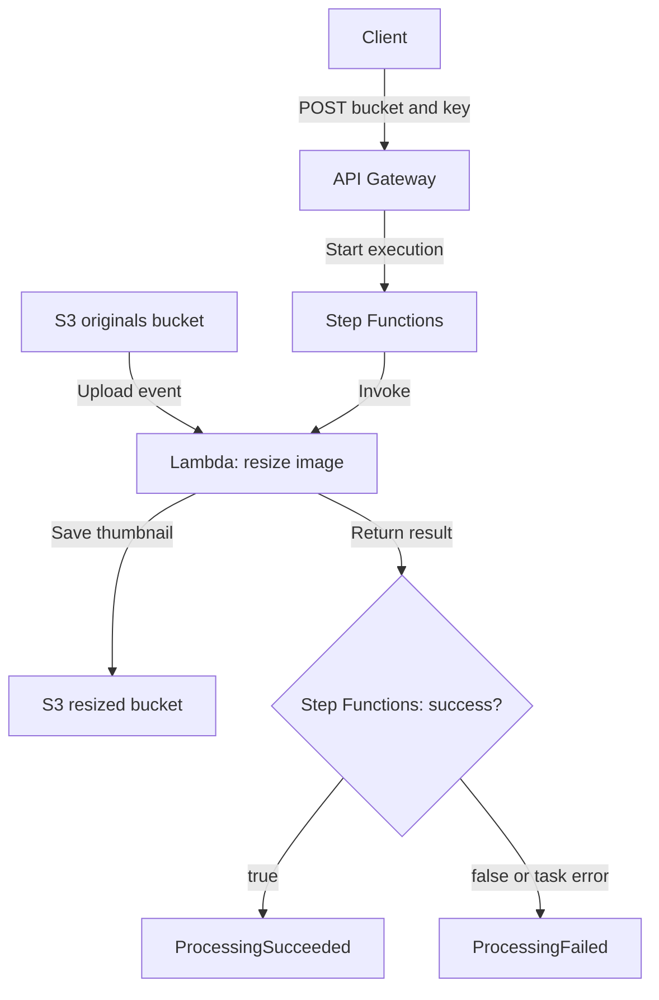

# Serverless Image Processing

Cloud Computing capstone by Aniruddh Choudhury.

This project uses Amazon S3, AWS Lambda, Step Functions, and API Gateway to create image thumbnails.

Images are resized to fit within 200 × 200 pixels while keeping their original proportions. The original image stays in the source bucket, and the thumbnail is saved in a separate bucket.

## How it works

There are two ways to run the image processing:

1. Upload an image to the originals bucket. S3 automatically triggers Lambda to resize it.
2. Send a POST request to API Gateway with the image's bucket name and key. API Gateway starts Step Functions, which calls Lambda and checks whether processing succeeded.

## Project files

- `lambda_function.py`: Reads the image from S3, resizes it using Pillow, and saves the thumbnail.
- `state_machine.json`: Defines the workflow, including its success and failure paths.
- `README.md`: Explains the architecture, deployment, and testing.

## Architecture



Lambda reads the original image from S3 in both paths. Step Functions checks the result only when it invokes Lambda.
## Prerequisites

- An AWS account with permission to create S3 buckets, Lambda functions, IAM roles, Step Functions workflows, and API Gateway APIs.
- AWS CloudShell to prepare the Pillow layer and test the API.
- A JPEG or PNG image for testing.
- Use the us-east-1 region for this deployment.

## Deployed resources

| Resource | Name or value |
| --- | --- |
| Region | us-east-1 |
| Originals bucket | capstone-originals-aniruddh-000570186 |
| Resized bucket | capstone-resized-aniruddh-000570186 |
| Lambda function | capstone-resize-image |
| Lambda runtime | Python 3.13 |
| Lambda architecture | x86_64 |
| Pillow layer | capstone-pillow-layer |
| Step Functions workflow | capstone-image-workflow |
| API Gateway API | capstone-image-api |
| API stage | prod |

**stateMachineARN:**
`arn:aws:states:us-east-1:570017719522:stateMachine:capstone-image-workflow`

**finalAPIURL:**
https://04ga0s25ai.execute-api.us-east-1.amazonaws.com/prod

The API accepts POST requests containing the source image's bucket name and key.
## Deployment instructions

### 1. Create the S3 buckets

Create two S3 buckets in us-east-1:

- Source: capstone-originals-aniruddh-000570186
- Destination: capstone-resized-aniruddh-000570186

Keep Block all public access enabled and ACLs disabled. Use the default SSE-S3 encryption.

S3 bucket names must be globally unique. If deploying in another account, choose your own bucket names and update the configuration and permissions accordingly.

The source bucket stores original images. The destination bucket stores resized images. Separate buckets prevent saved thumbnails from triggering the same processing again.
### 2. Create the Pillow Lambda layer

Open AWS CloudShell and run:

```bash
mkdir -p ~/capstone-pillow-layer/python
cd ~/capstone-pillow-layer

python3 -m pip install Pillow==13.0.0 \
  --platform manylinux_2_28_x86_64 \
  --only-binary=:all: \
  --target python

zip -r pillow-layer.zip python
```

Download this file using CloudShell's Actions → Download file:

```text
/home/cloudshell-user/capstone-pillow-layer/pillow-layer.zip
```

In Lambda → Layers, create a layer with these settings:

- Name: capstone-pillow-layer
- Upload: pillow-layer.zip
- Compatible architecture: x86_64
- Compatible runtime: Python 3.13

The ZIP contains a top-level `python` folder so Lambda can load the Pillow library.
### 3. Create and configure Lambda

Create a Lambda function with these settings:

- Function name: capstone-resize-image
- Runtime: Python 3.13
- Architecture: x86_64
- Execution role: Create a new role with basic Lambda permissions.

Paste the contents of `lambda_function.py` into the function's code editor and deploy it.

Set the handler to `lambda_function.lambda_handler`.

Attach version 1 of the `capstone-pillow-layer` layer.

Under Configuration → General configuration, set:

- Memory: 512 MB
- Timeout: 30 seconds

Under Configuration → Environment variables, add:

| Key | Value |
| --- | --- |
| DESTINATION_BUCKET | capstone-resized-aniruddh-000570186 |

If using different bucket names, set this variable to your destination bucket's name.
### 4. Give Lambda access to S3

Open the Lambda function's execution role in IAM.

Keep its basic Lambda logging permissions. Add an inline policy named `capstone-s3-image-access` using this JSON:

```json
{
  "Version": "2012-10-17",
  "Statement": [
    {
      "Effect": "Allow",
      "Action": "s3:GetObject",
      "Resource": "arn:aws:s3:::capstone-originals-aniruddh-000570186/*"
    },
    {
      "Effect": "Allow",
      "Action": "s3:PutObject",
      "Resource": "arn:aws:s3:::capstone-resized-aniruddh-000570186/*"
    }
  ]
}
```

If deploying with different bucket names, update both resource ARNs.

This policy allows Lambda to read objects from the originals bucket and write objects to the resized bucket.

### 5. Add the S3 trigger

Open the `capstone-resize-image` Lambda function and choose Add trigger.

Configure the trigger:

- Source: S3
- Bucket: capstone-originals-aniruddh-000570186
- Event types: All object create events
- Prefix: Leave blank
- Suffix: Leave blank

Acknowledge the recursive invocation warning and add the trigger.

The function writes thumbnails to a separate destination bucket, so those writes do not trigger it again.

Uploading an image to the originals bucket now automatically invokes Lambda.

### 6. Create the Step Functions workflow

In Step Functions, create a state machine with these settings:

- Name: capstone-image-workflow
- Type: Standard

Open the Code editor and paste the contents of `state_machine.json`.

If deploying in another account or region, update the `Resource` ARN in the `ResizeImage` state to match your Lambda function.

Choose Create new role so Step Functions can generate an execution role with permission to invoke the Lambda function. Create the state machine.

The workflow runs these steps:

1. `ResizeImage` invokes Lambda.
2. `CheckResult` checks whether Lambda returned `success: true`.
3. `ProcessingSucceeded` ends the workflow successfully.
4. `ProcessingFailed` ends it with a failure if the result is unsuccessful.

The `Catch` rule on `ResizeImage` also sends task errors directly to `ProcessingFailed`.

Copy the state machine ARN for the API Gateway configuration.
### 7. Create the API Gateway execution role

In IAM, create a role named `capstone-api-stepfunctions-role`.

Choose AWS service as the trusted entity and API Gateway as the service. The API Gateway wizard attaches its CloudWatch logging policy.

The role's trust policy must allow API Gateway to assume it:

```json
{
  "Version": "2012-10-17",
  "Statement": [
    {
      "Effect": "Allow",
      "Principal": {
        "Service": "apigateway.amazonaws.com"
      },
      "Action": "sts:AssumeRole"
    }
  ]
}
```

Add an inline permissions policy named `capstone-start-workflow`:

```json
{
  "Version": "2012-10-17",
  "Statement": [
    {
      "Effect": "Allow",
      "Action": "states:StartExecution",
      "Resource": "arn:aws:states:us-east-1:570017719522:stateMachine:capstone-image-workflow"
    }
  ]
}
```

If deploying in another account or region, replace the Resource value with your state machine ARN.

Copy the role ARN for the API Gateway integration.
### 8. Create and deploy API Gateway

Create a REST API named `capstone-image-api` with a Regional endpoint.

On the root resource `/`, create a POST method with these integration settings:

| Setting | Value |
| --- | --- |
| Integration type | AWS service |
| AWS Region | us-east-1 |
| AWS service | Step Functions |
| AWS subdomain | Leave blank |
| HTTP method | POST |
| Action type | Use action name |
| Action name | StartExecution |
| Execution role | arn:aws:iam::570017719522:role/capstone-api-stepfunctions-role |

If deploying in another account, use your API Gateway execution role ARN.

Save the method. Under Integration request, add a mapping template with content type `application/json`:

```text
{
  "input": "$util.escapeJavaScript($input.body).replaceAll("\\'","'")",
  "stateMachineArn": "arn:aws:states:us-east-1:570017719522:stateMachine:capstone-image-workflow"
}
```

Replace the state machine ARN if deploying your own workflow.

The template converts the request body into the input string expected by Step Functions and specifies which workflow to start.

Save the integration request and deploy the API to a stage named `prod`.

Copy the stage's invoke URL. Redeploy to `prod` after making API configuration changes.
## Running and testing

### 1. Test automatic processing through S3

1. Upload a JPEG or PNG image to the originals bucket.
2. Open the resized bucket and refresh the object list.
3. Confirm that a thumbnail appears with the same object key.
4. Download the thumbnail and check its dimensions.

The thumbnail should fit within 200 × 200 pixels while preserving the image's proportions.

Test result: Uploading the test JPEG automatically created a thumbnail in the resized bucket. The original file was approximately 72 KB, and the thumbnail was approximately 5.5 KB. The downloaded thumbnail measured 200 × 150 pixels.
### 2. Test the workflow's success path

Open `capstone-image-workflow` in Step Functions and choose Start execution.

Use this input for the image already uploaded:

```json
{
  "bucket": "capstone-originals-aniruddh-000570186",
  "key": "WhatsApp Image 2026-09-15 at 2.59.35 PM.jpeg"
}
```

For another image, replace the key with its exact S3 object key.

Expected path: `ResizeImage` → `CheckResult` → `ProcessingSucceeded`.

Test result: The execution succeeded.

### 3. Test the workflow's failure path

Start another execution using a key that does not exist:

```json
{
  "bucket": "capstone-originals-aniruddh-000570186",
  "key": "missing-image.jpg"
}
```

Lambda returns `success: false` when it cannot retrieve the image. The Choice state then routes the execution to `ProcessingFailed`.

Test result: The execution failed as expected, confirming that the unsuccessful result follows the failure path.
### 4. Test through API Gateway

After uploading the image to the originals bucket, open AWS CloudShell and run:

```bash
curl -i -X POST 'https://04ga0s25ai.execute-api.us-east-1.amazonaws.com/prod' \
  -H 'Content-Type: application/json' \
  -d '{"bucket":"capstone-originals-aniruddh-000570186","key":"WhatsApp Image 2026-09-15 at 2.59.35 PM.jpeg"}'
```

If using another deployment or image, replace the API URL, bucket name, and object key.

The request sends the location of an existing S3 image. It does not upload the image itself.

The API should return HTTP 200 and a JSON response containing:

- `executionArn`: Identifies the workflow execution that started.
- `startDate`: Indicates when the execution started.

HTTP 200 confirms that the workflow started. Check its final status separately:

1. Open Step Functions → capstone-image-workflow.
2. Refresh the executions list.
3. Open the execution matching the returned execution ARN.
4. Confirm that its status is Succeeded.
5. Check the resized bucket for the output image.

Test result: The API returned HTTP 200 and an execution ARN. The matching execution, `8490697c-6236-4d5c-ad4e-30bdc1abb819`, succeeded.

## Test results summary

| Test | Result |
| --- | --- |
| Upload an image to the originals bucket | Lambda automatically created a thumbnail in the resized bucket |
| Check thumbnail dimensions | Downloaded thumbnail measured 200 × 150 pixels |
| Start Step Functions with an existing image key | Execution succeeded |
| Start Step Functions with a missing image key | Execution followed the expected failure path |
| Send a POST request to API Gateway | API returned HTTP 200 and an execution ARN |
| Check the API-triggered execution | Execution succeeded |